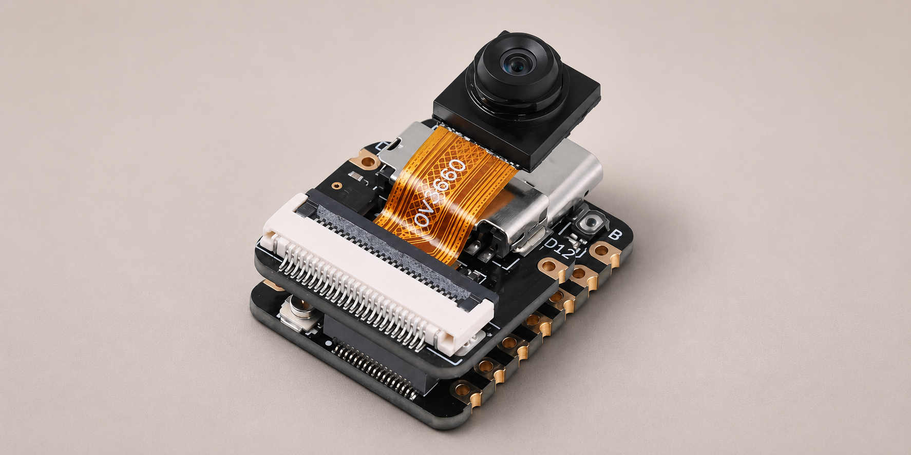
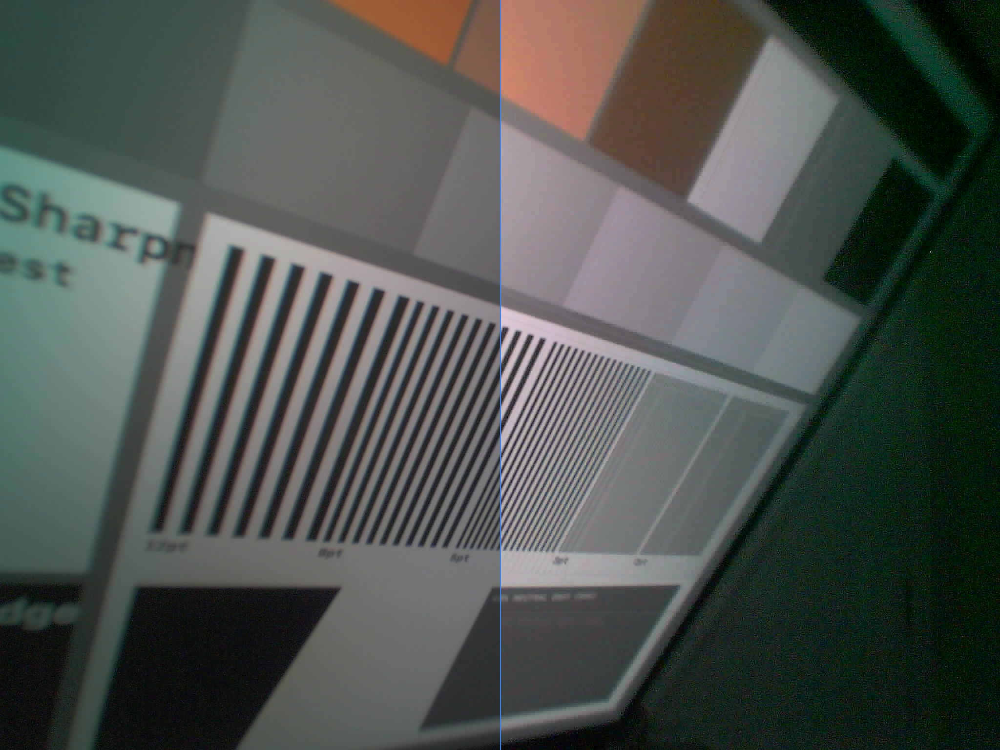

# XIAO Camera Stream

Local Wi-Fi video from a XIAO ESP32-S3 Sense with an OV3660 camera. Power it from USB or a power bank, then open the camera in a browser. The optional Go viewer processes the image on your Mac.



## Connect

- **At home**, the camera joins its saved 2.4 GHz Wi-Fi. Keep your phone or computer on the same LAN and open the camera’s IP address. Find it in your router’s device list or send `info` over USB serial at 115200 baud.
- **Away from home**, the camera creates **XIAO-Cam** if it has no saved network or cannot join it within eight seconds of trying. Join XIAO-Cam with the passphrase from your local `firmware/xiao_stream/wifi_private.h`, then open http://192.168.4.1. The viewer works offline. To use a new router, enter its Wi-Fi details on that page. The camera saves them and restarts.

## Choose a mode

| Mode | Resolution | For |
| --- | --- | --- |
| Performance | 480 × 320 | Fast motion |
| Balanced (default) | 1024 × 768 | Everyday viewing |
| Quality | 2048 × 1536 | Still photos and fine detail |

Switch modes in the viewer. For a still, open `/capture` on the camera. For a direct MJPEG feed, open `http://<camera-ip>:81/stream`.



*Quality mode on the bench. Original frame on the left, Mac processing on the right.*

## Run the Mac viewer

From the project root, replace `CAMERA_IP` with the board’s address. Open http://127.0.0.1:8090 after launch.

```sh
cd client
go run . -host CAMERA_IP
```

<details>
<summary>Build the firmware or run the benchmark</summary>

## Firmware build

The tested toolchain uses the Arduino ESP32 core 4.0.0. The private header defines the C++ string constant `kApPass` for the camera’s Wi-Fi access point. Keep this file local. For a fresh checkout, create the header with a passphrase of 8–63 ASCII characters.

```sh
board='esp32:esp32:XIAO_ESP32S3:PSRAM=opi,FlashMode=qio,CPUFreq=240,PartitionScheme=default_8MB,USBMode=hwcdc,CDCOnBoot=default,EraseFlash=none,UploadSpeed=921600,DebugLevel=warn'
arduino-cli compile --fqbn "$board" --upload -p /dev/cu.usbmodem1101 firmware/xiao_stream
```

To benchmark from the project root on macOS, point the camera at the Mac display and run the chart and receiver together.

```sh
swiftc tools/screen_test.swift -o tools/screen_test
tools/screen_test &
chart_pid=$!
(cd client && go run . -host CAMERA_IP -benchmark -seconds 20 -screen-url http://127.0.0.1:8099 -out bench_run)
kill "$chart_pid" 2>/dev/null || true
```

The benchmark saves original and processed JPEGs alongside a JSON report of decoded FPS, frame intervals and screen-change-to-receipt latency.

</details>
